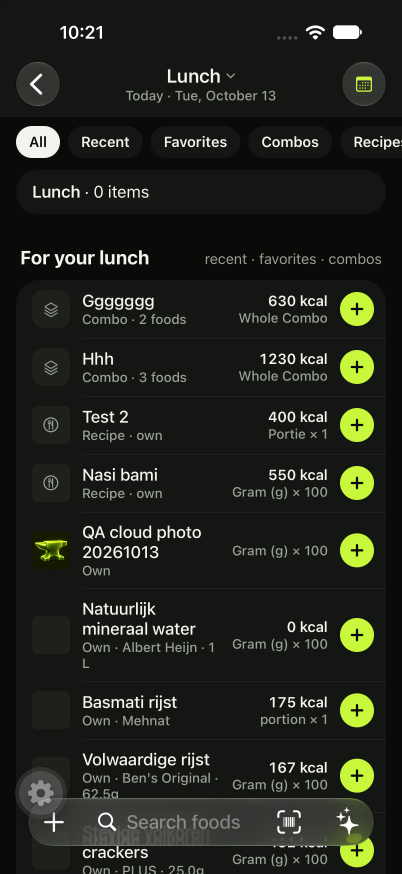

# Food photos and local account cache retirement

Revision `a72f220`; iPhone 18 Pro simulator, iOS 27.0, regular development
`colorless-sturgeon-704`; preview backend `fine-akita-444`.

Follow-up to issue 89 after the sole user confirmed build 20 upload and cleanup.
Manual Food and One-off Entry photos now use Convex storage IDs; OFF visuals use
provider URLs with `expo-image` memory/disk caching. Existing ambiguous OFF images
adopt the provider image. Custom OFF crops become own account photos.

Account library and revision stores use independent in-memory SQLite connections.
Diary/goals/measures/servings snapshots use bounded session maps. Disk retains
optional remembered portions/favorites, goal display order, bounded OFF request
cache, general device settings and Set Drafts. Empty legacy source files and old
account mirrors are retired. Unknown originals and unacknowledged legacy journals
are guarded; an old manual photo source survives until upload acknowledgement.

Removed the legacy library outbox, diary replay, saved-note database and recipe
migration implementation. New writes still require a connection and server ACK;
failed editor input remains available for retry while the editor stays open.

## Automated verification

- Root: 63 suites, 455 tests passed.
- Mobile: 91 suites, 565 tests passed.
- Root and mobile TypeScript passed; Biome/mobile architecture passed.
- Web build passed.
- Public Convex API tests cover photo ownership, fresh reads, frozen diary values,
  OFF conversion and account-specific test-data photo removal.
- Repository tests cover nonpersistent snapshots, retained optional defaults,
  legacy pending-write protection and server ACK surviving optional disk failure.

## Rollout status

Regular development backend `colorless-sturgeon-704` deployed successfully.
The old isolated deployment `earnest-cobra-841` is no longer accessible.
Production backend `fine-akita-444` deployed successfully. Provider adoption
changed five Foods and four Diary Entries in development, and 54 Foods and 110
Diary Entries in production. A complete second dry run found zero eligible
changes in either deployment. Nutrition values remain frozen.

A native manual photo save completed; its stored record contains a storage ID
and no device URI. Independent cloud retrieval returned a 34,091-byte JPEG.
After deleting only that QA photo source and the disposable image cache, a cold
start reloaded the Food and displayed its image from Convex. The temporary QA Food
was removed afterward. Its uploaded file is retained under the same policy as
historical photos; no account-wide destructive reset was run.

The simulator’s SQLite directory contains only `workouts-off-cache.db`,
`workouts-nutrition-state.db` and `ExpoSQLiteStorage`; account mirrors, migration
files and durable diary journals are gone. [Table counts](simulator-sqlite.json).
Physical phone SQLite counts are not inferred from these simulator results.

EAS preview build 21 and its submission finished. Apple processing is `VALID`;
its internal state is `IN_BETA_TESTING`. Group lookup completed and confirmed
access through the existing **Team (Expo)** internal group (all-build access).
Apple build ID `4c540e02-65c4-47ee-8a44-ee39fae3a0cf`. EAS build ID
`2ba643b2-cb4e-4e74-984d-e3b3ec574ce0`; submission
`b1444919-8527-401e-a302-d10eb50e9343`; source revision `a72f220`.
Main is merged and pushed; GitHub CI and CLI checks passed at `55038a4`.
Regular development is running from this checkout on port 8191. Main’s documentation
restructure was merged first, preserving its layout and unrelated mobile changes.

## Follow-up

Pending acceptance: #110.
