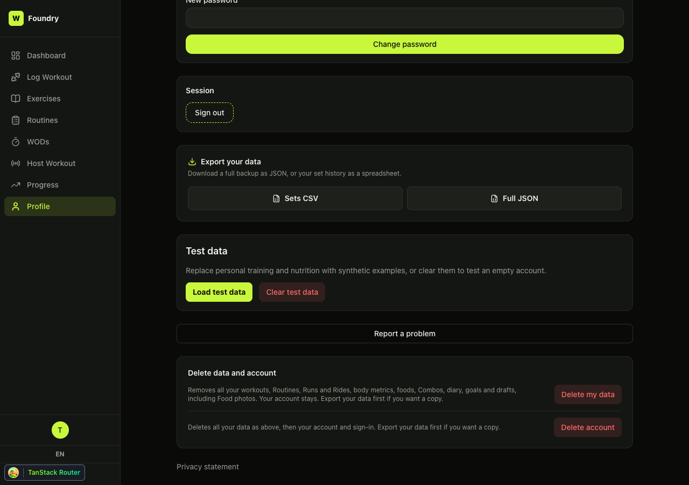
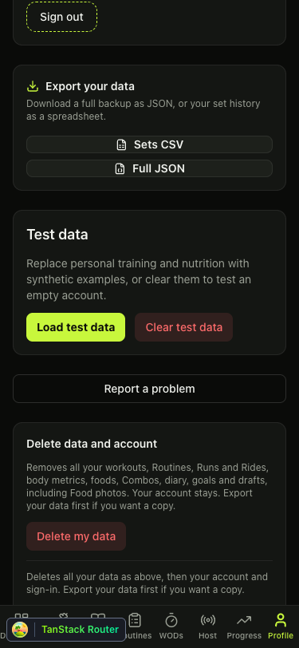
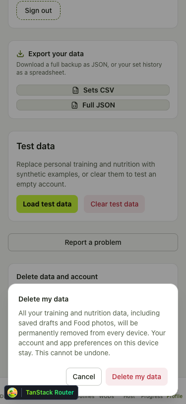
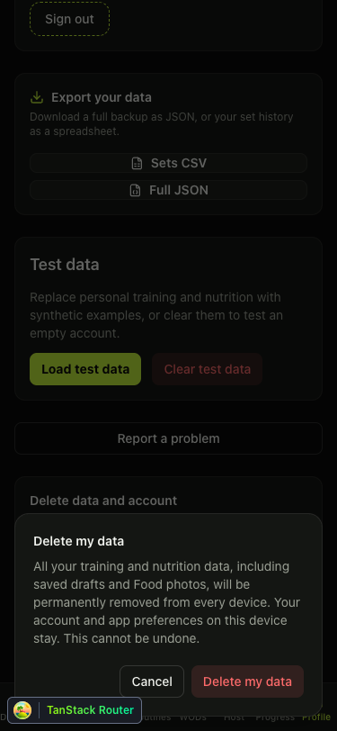
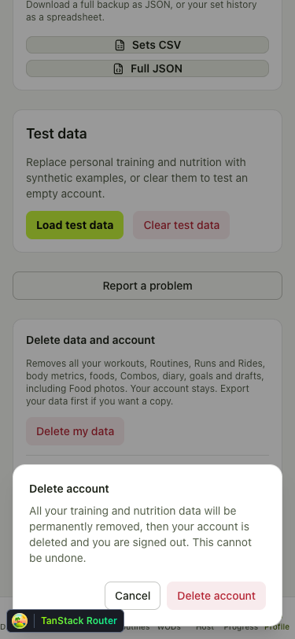
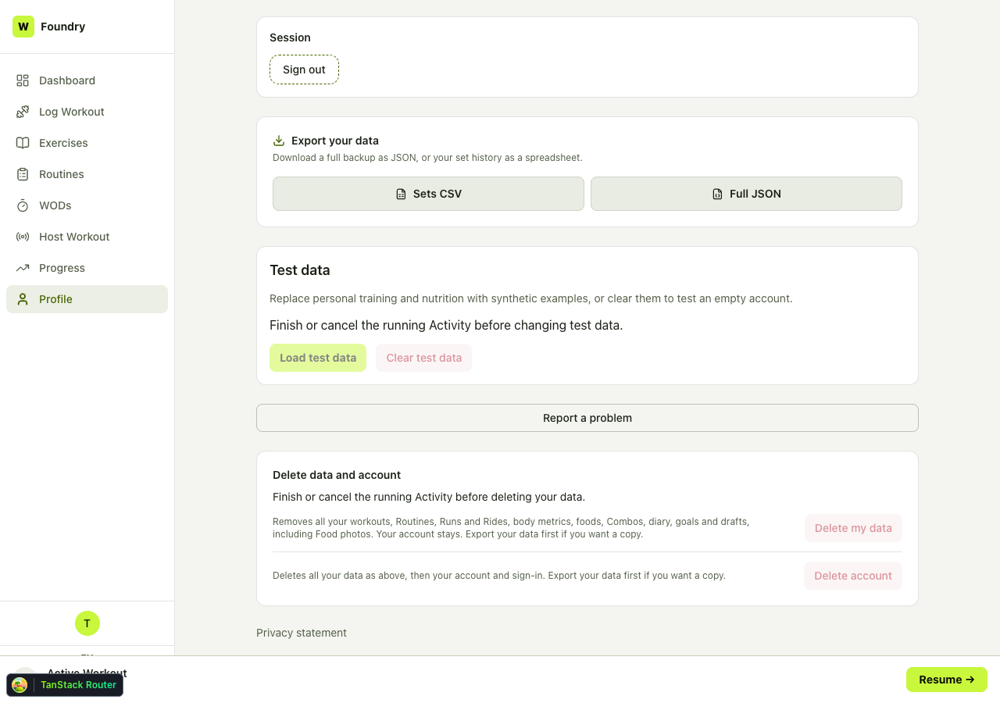
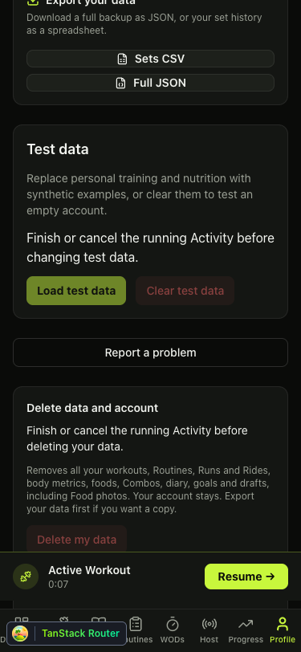

# Web data and account deletion — APP-34

Runtime screenshots of the web Account page's "Delete data and account" card,
taken with Vite dev and headless Chromium against the shared dev deployment,
signed in with the documented test account, in English. Desktop is 1280 px wide,
small screen 375 px; light and dark come from `prefers-color-scheme`.

The blocked state was produced by starting an empty Strength Session and
opening Account; the session was cancelled afterwards and the card re-enabled
without a reload. No data or account was deleted in these runs: the confirm
dialogs were cancelled. A live deletion run needs a throwaway Clerk development
user, which is pending (see the PR's leftover work).

## Sign-out race after Delete account

After `user.delete()` Clerk is signed out, so the signed-in layout mounts
`RedirectToSignIn` while the card does a replace + full load of `/`. Without
deleting anything, the same sequence was reproduced with the test account:
`Clerk.setActive({ session: null })`, then `window.location.replace("/")`
after 0, 50 and 300 ms. Every run ended on `/`; none reached `/sign-in`.

| State | Desktop | 375 px |
| --- | --- | --- |
| Card, light |  |  |
| Card, dark |  |  |
| Delete my data confirm, light |  |  |
| Delete my data confirm, dark |  |  |
| Delete account confirm, light |  |  |
| Delete account confirm, dark |  |  |
| Blocked (running Activity), light |  |  |
| Blocked (running Activity), dark |  |  |
