# Web data and account deletion — APP-34

Runtime screenshots of the web Account page's "Delete data and account" card,
taken with Vite dev and headless Chromium against the shared dev deployment,
signed in with the documented test account, in English. Desktop is 1280 px wide,
small screen 375 px; light and dark come from `prefers-color-scheme`.

The blocked state was produced by starting an empty Strength Session and
opening Account; the session was cancelled afterwards and the card re-enabled
without a reload. No data or account was deleted in these screenshot runs: the
confirm dialogs were cancelled. The live deletion run is below.

## Sign-out race after Delete account

After `user.delete()` Clerk is signed out, so the signed-in layout mounts
`RedirectToSignIn` while the card does a replace + full load of `/`. Without
deleting anything, the same sequence was reproduced with the test account:
`Clerk.setActive({ session: null })`, then `window.location.replace("/")`
after 0, 50 and 300 ms. Every run ended on `/`; none reached `/sign-in`.

| State | Desktop | 375 px |
| --- | --- | --- |
| Card, light | 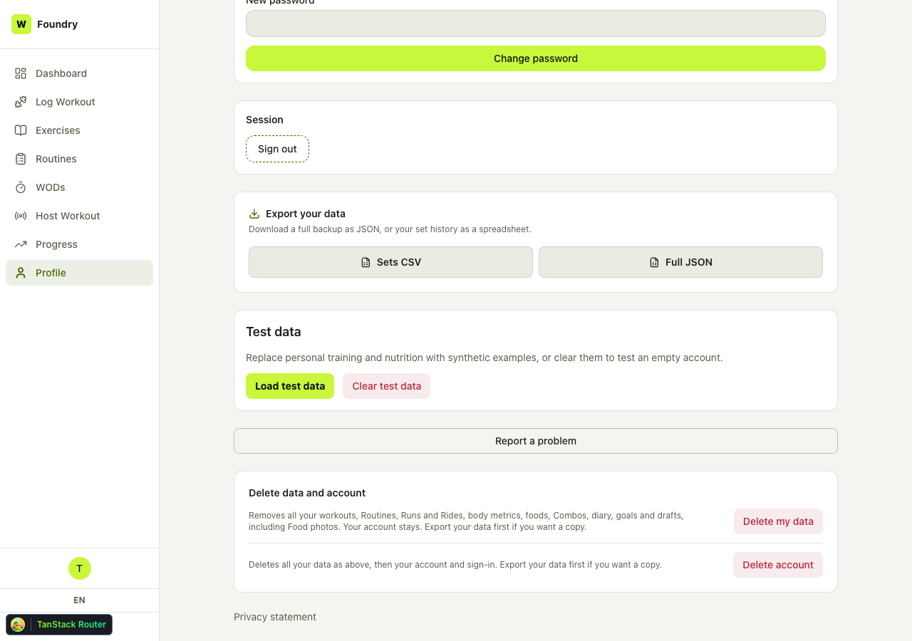 | 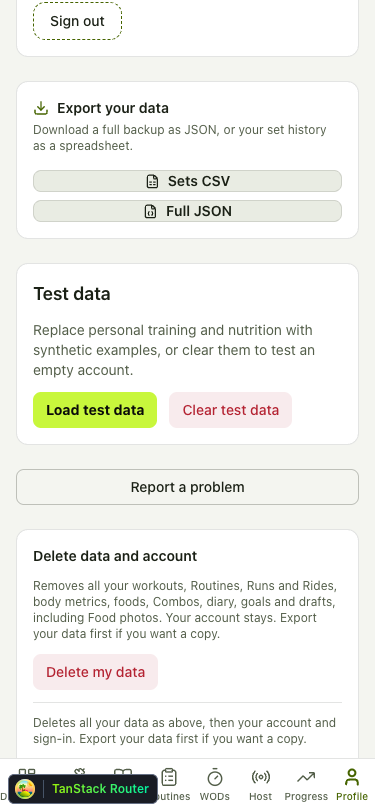 |
| Card, dark |  |  |
| Delete my data confirm, light |  |  |
| Delete my data confirm, dark | 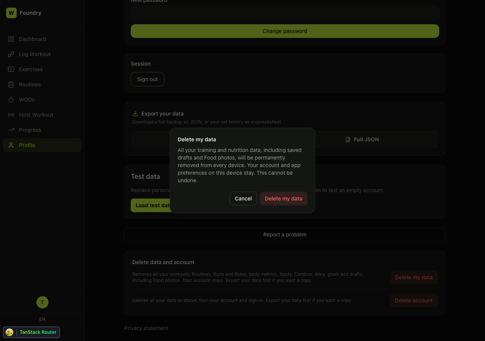 |  |
| Delete account confirm, light | 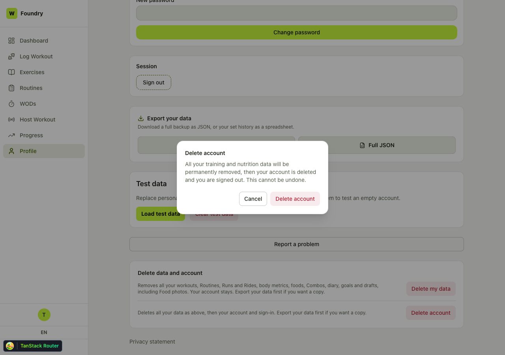 |  |
| Delete account confirm, dark | 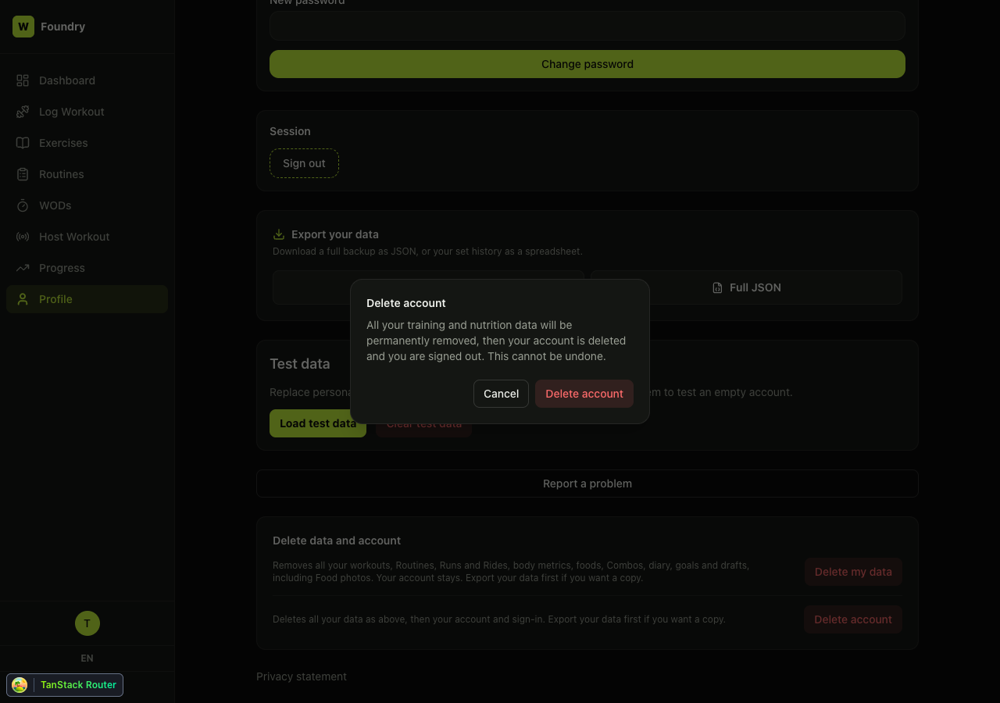 | 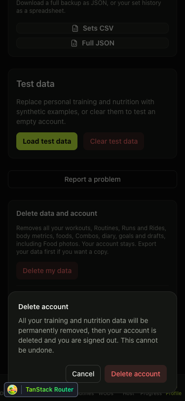 |
| Blocked (running Activity), light |  | 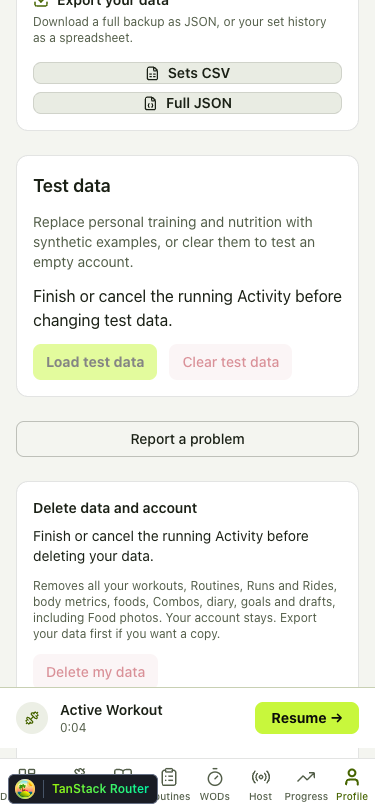 |
| Blocked (running Activity), dark | 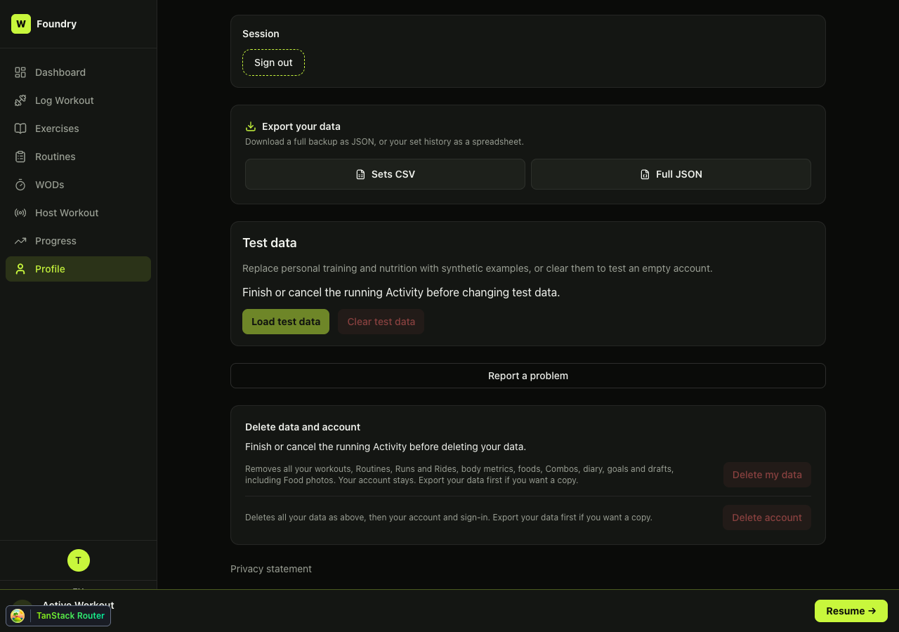 |  |

## Live deletion run

On 17 November 2026, at commit 45241e3a, against the shared dev deployment,
with a throwaway user on the Clerk development instance
(`app34-deletion+clerk_test@example.com`, `user_3MFhEFIwp5qFRrj3oWcKGF51gax`).
Headless Chromium, 1280 px, English, client-side navigation. The script
checked `Clerk.user.id` before every deletion step.

1. Signed in with an email code. Logged a body metric (81.2 kg) on Progress >
   Body and added the custom exercise "APP-34 Test Raise".
2. Account > Delete my data > confirmed. The toast said "Your data was
   deleted." Progress > Body then showed no measurements, and the trend showed
   its empty text. Exercises no longer listed "APP-34 Test Raise". No reload
   was needed.
3. Account > Delete account > confirmed. The page ended on `/` (navigations
   `/ -> /`), `Clerk.user` was `null`, and the signed-out start page showed.
4. Requesting a sign-in code for the same email said "No account uses this
   email address." The Clerk Backend API returns "not found" for the user ID.

| Step | Screenshot |
| --- | --- |
| Body metric logged | 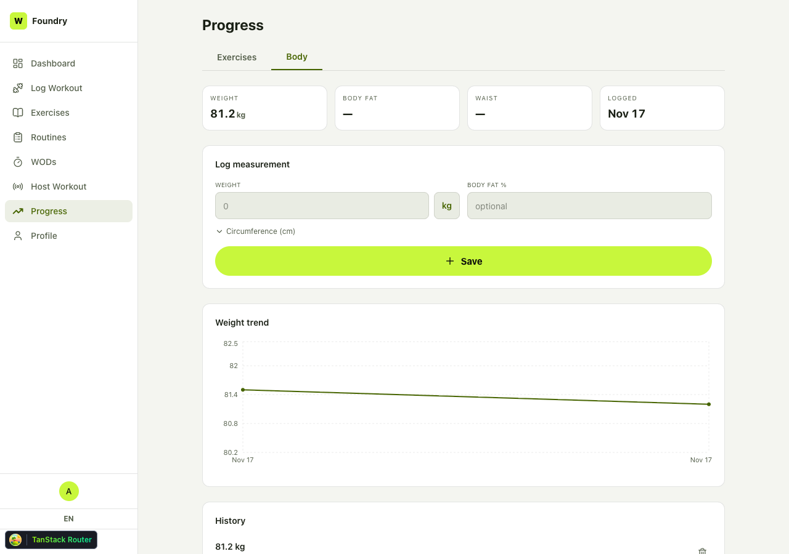 |
| Custom exercise added | 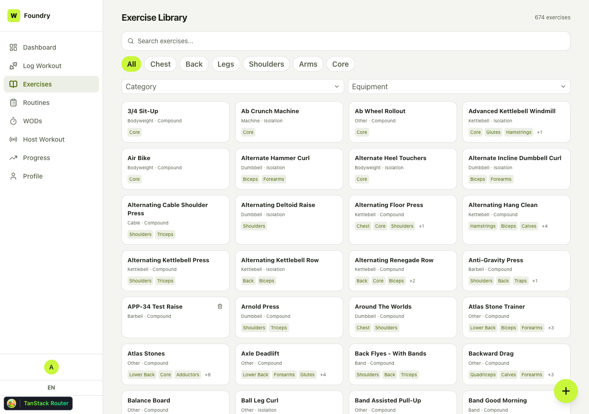 |
| Delete my data done | 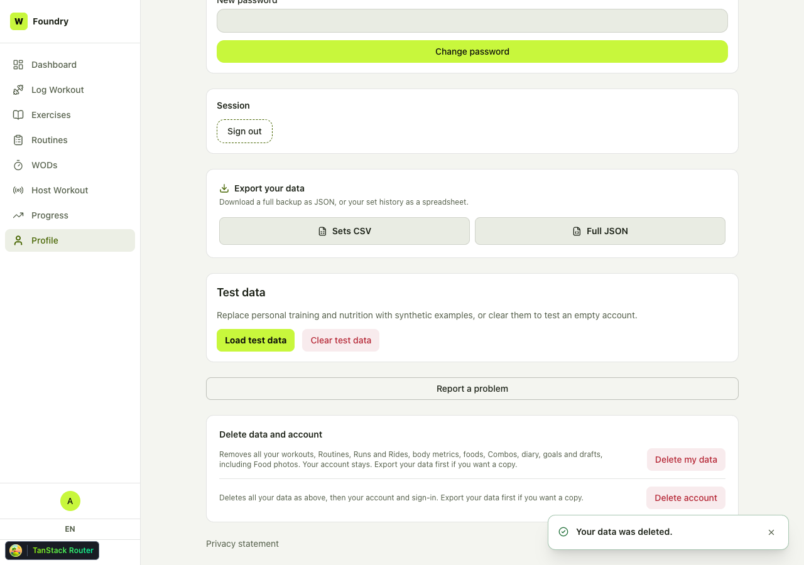 |
| Body empty after deletion | 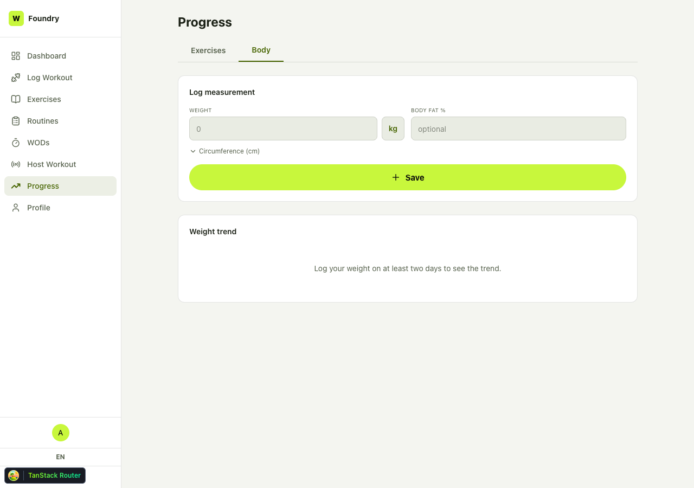 |
| Custom exercise gone | 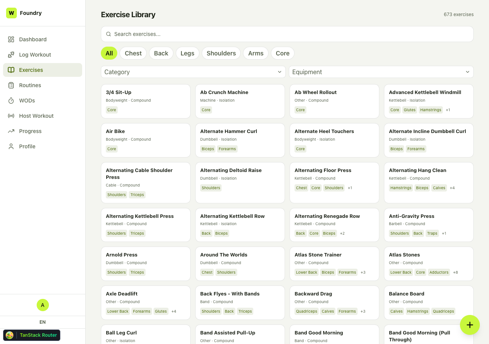 |
| Signed-out start after Delete account | 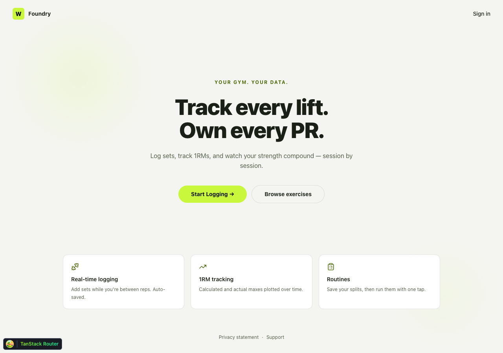 |
| Sign-in finds no account | 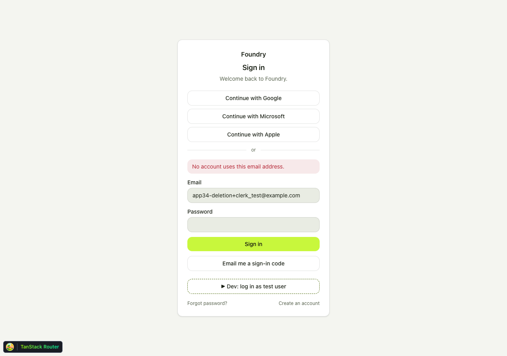 |

## Full reload of a signed-in page

With the dev test account, reloading or opening a signed-in URL directly shows
"Something went wrong. Sign in again to continue."
([screenshot](reload-headed.png)); client-side navigation works. It happens
in headed and headless Chrome for Testing with a fresh profile, on `/account`
and on `/progress`, which this PR does not change. So it predates this PR. It
was not tried in a regular Chrome profile.
