# Delete Foundry data or the whole AppElent account — APP-398

All runs used an isolated local Convex deployment
(`convex dev` on 127.0.0.1:3210, HTTP actions on :3211) with the Clerk
**development** instance. Production Convex and the Clerk production instance
were not touched, and no Clerk user was created or deleted.

## Web screenshots

Vite dev, signed in with the documented test account, English. Desktop is
1280 px wide, small screen 375 px; light and dark come from
`prefers-color-scheme`.

| State | Desktop | 375 px |
| --- | --- | --- |
| Card, light | 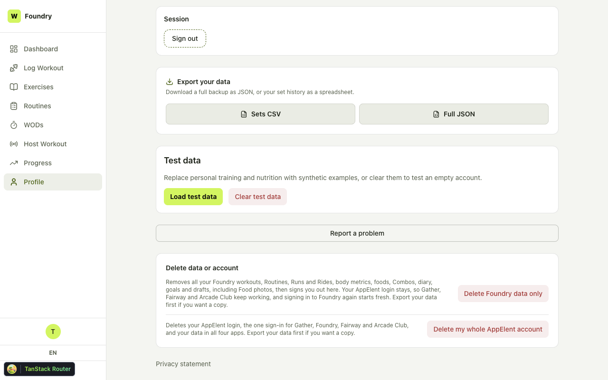 | |
| Card, dark | 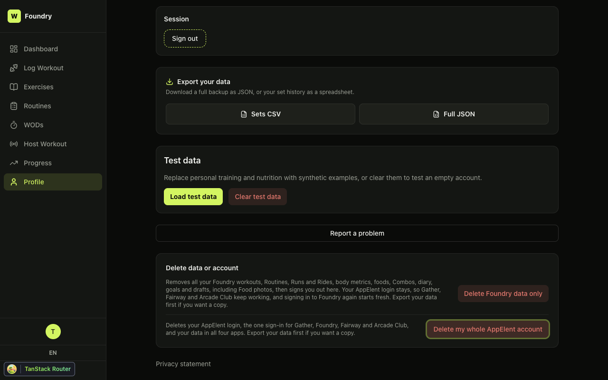 | 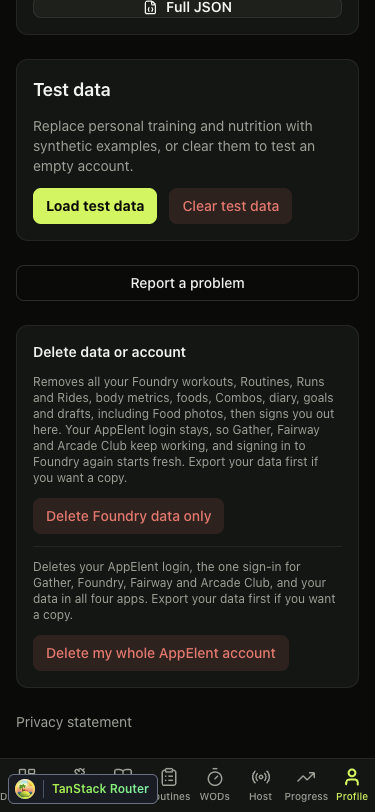 |
| Delete Foundry data only confirm, light | 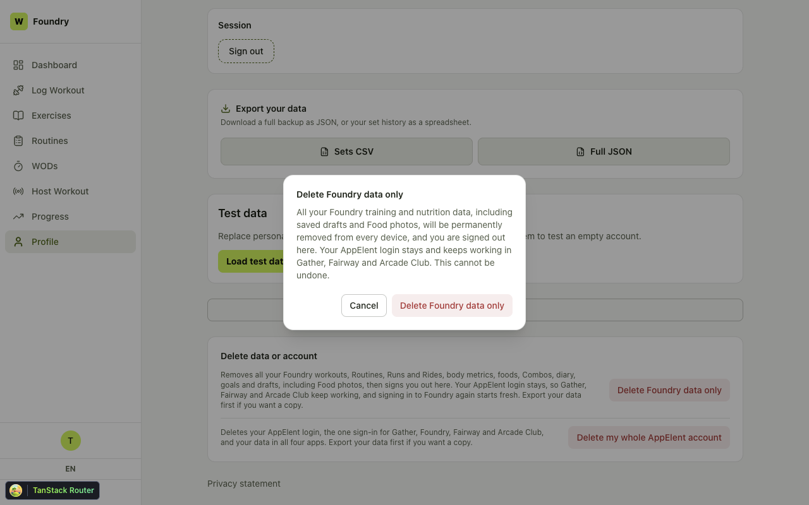 | 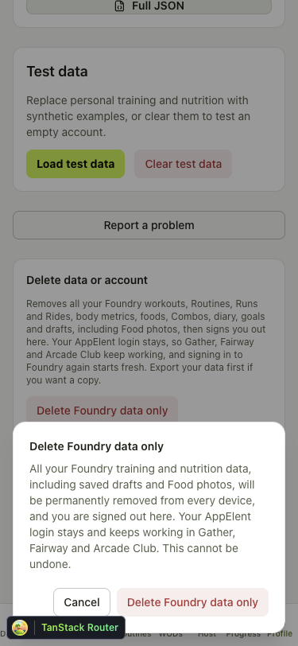 |
| Delete Foundry data only confirm, dark | | 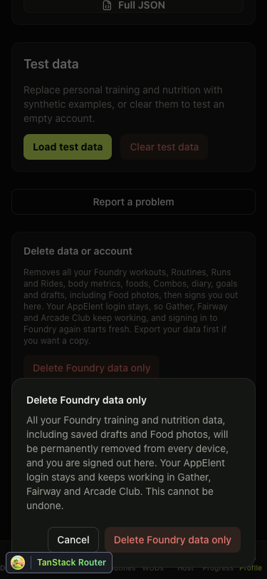 |
| Delete my whole AppElent account confirm, dark | 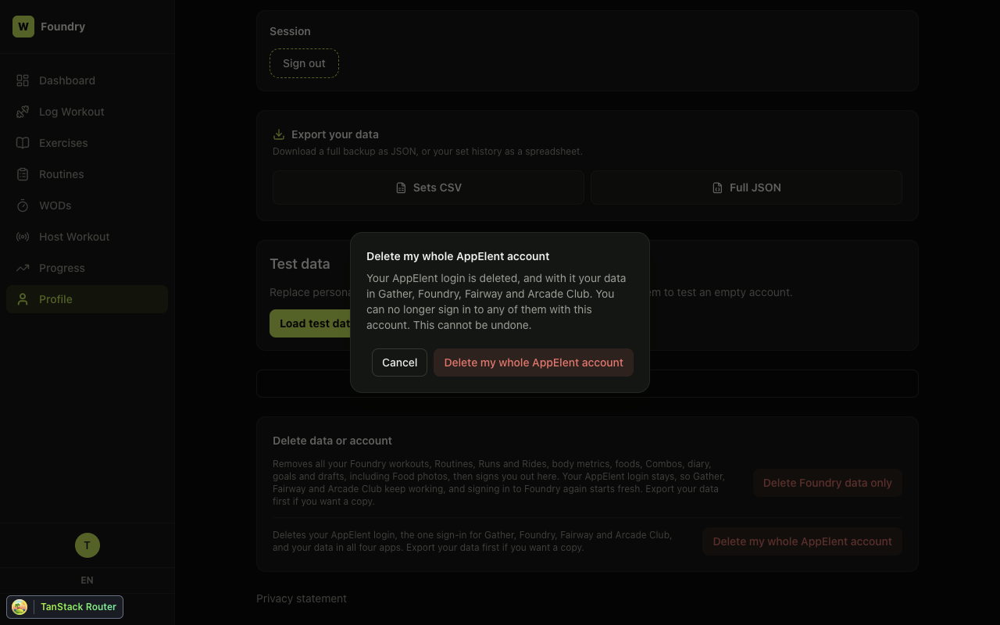 | |
| Signed-out start after Delete Foundry data only | | 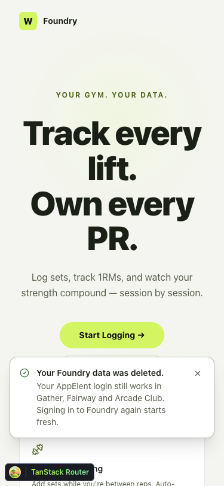 |
| Signing in again: empty account | | 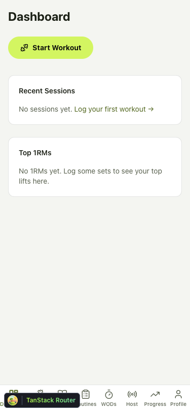 |

## iOS screenshots

Development dev client on iOS 27 simulators (iPhone 18 Pro, English; iPhone
SE 3rd generation, Dutch), Metro serving the shared **dev** deployment
(`run-mobile.mjs` backend check passed). The dev test account had a running
Activity from another thread, so both buttons show the blocked state; that
Activity was left alone and nothing was deleted on dev. The confirm dialogs and
the data-only flow on iOS are covered by `account-screen.test.tsx`.

| State | iPhone 18 Pro (en) | iPhone SE (nl) |
| --- | --- | --- |
| Account, light | 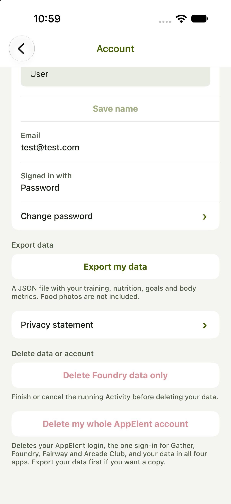 | 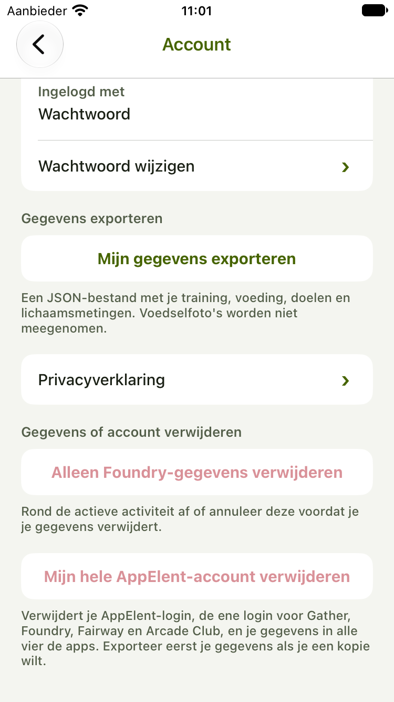 |
| Account, dark | 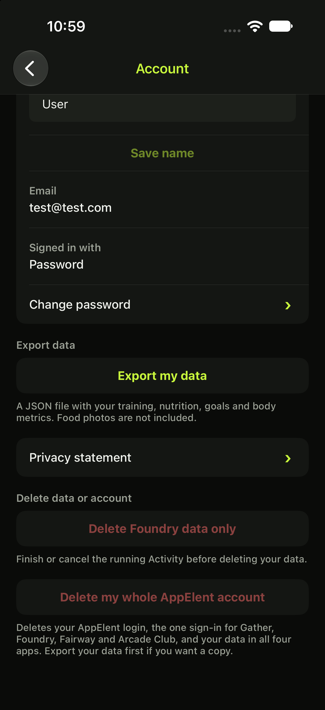 | 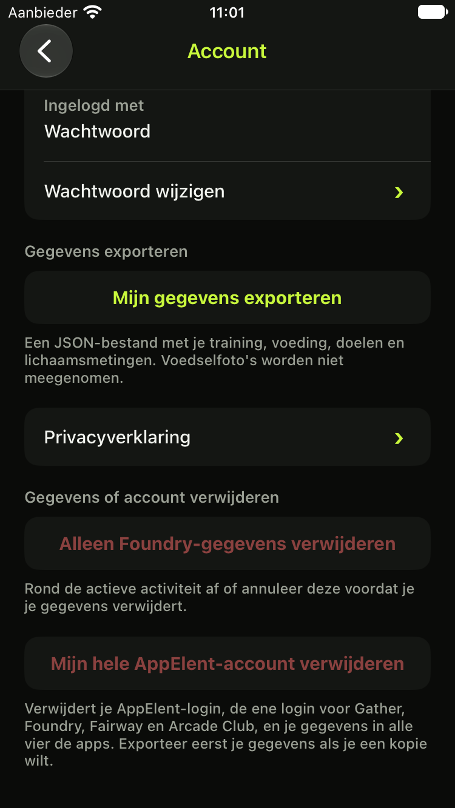 |

## Live run: Delete Foundry data only (web)

Test account `user_2tTl…` on the local deployment, seeded with test data; a
second seeded user (`user_proof_bob`) is the control.

1. Account → **Delete Foundry data only** → confirm.
2. The app left the signed-in pages, Clerk signed out this session and loaded
   `/?deleted=data`; the start page showed "Your Foundry data was deleted." and
   replaced the URL with `/`. `Clerk.user` was `null`.
3. Rows per table, before → after:

   | Table | Test user | Control |
   | --- | --- | --- |
   | workoutSessions | 6 → 0 | 6 → 6 |
   | sets | 24 → 0 | 24 → 24 |
   | exercises | 1 → 0 | 1 → 1 |
   | bodyMetrics | 3 → 0 | 3 → 3 |
   | activities | 2 → 0 | 2 → 2 |
   | nutritionDiaryEntries | 14 → 0 | 14 → 14 |
   | nutritionGoalVersions | 2 → 0 | 2 → 2 |
   | nutritionLibraryRecords | 4 → 0 | 4 → 4 |
   | oneRepMaxes | 3 → 0 | 3 → 3 |
   | routines | 2 → 0 | 2 → 2 |

4. Signing in again with the same login worked: the same Clerk user ID came
   back (the Clerk user was not deleted), `account.firstRun` answered
   `{ empty: true }`, and the dashboard was empty.

## Live run: Clerk `user.deleted` webhook

`POST http://127.0.0.1:3211/clerk/webhook`, signed with the deployment's
`CLERK_WEBHOOK_SECRET` (a random value for this local deployment only), for
two seeded users `user_proof_alice` and `user_proof_bob`:

```text
unsigned   user.deleted user_proof_alice -> HTTP 400
badsig     user.deleted user_proof_alice -> HTTP 401
signed     user.updated user_proof_alice -> HTTP 200
signed     user.deleted user_proof_alice -> HTTP 200
signed     user.deleted user_proof_alice -> HTTP 200   (repeat delivery)
signed     user.deleted user_never_used_foundry -> HTTP 200
```

The rejected and `user.updated` requests changed nothing. After the signed
`user.deleted`, every table above was 0 for alice and unchanged for bob
(the same counts as the control column above).

## Delete my whole AppElent account

Not run live: it deletes the Clerk user, which needs a throwaway Clerk dev user
from the hub. The flow is unchanged apart from copy and is covered by the
`DeleteAccountCard` and `account-screen` tests.
