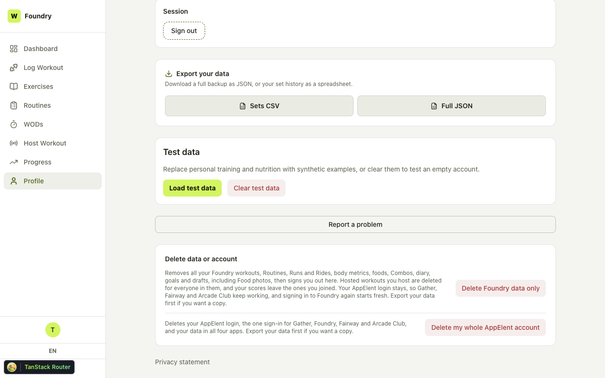
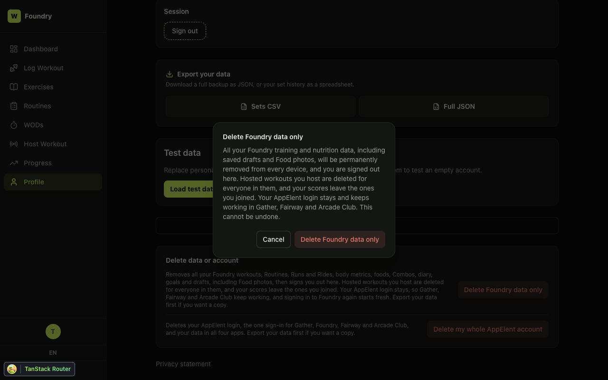
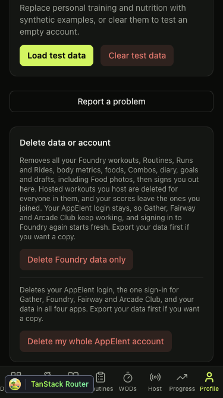

# Account deletion removes Hosted Workouts — APP-408

## Backend

Convex tests run in `convex-test`; no deployment was written to.

- `convex/account.hostedWorkouts.test.ts`: no blocker for Hosted Workouts;
  participant purge (score leaves another host's board, other athletes'
  rows unchanged); host purge (whole event, guest score included; a
  participant mid-event keeps their WODs and results, their session ends as
  completed and opens as an ordinary session); 3,500 guest submissions
  deleted over several bounded calls; a repeat run changes nothing.
- `convex/http.test.ts`: the Clerk `user.deleted` webhook leaves the same
  database as in-app deletion for an account that hosts one event and
  joined another.

## Web screenshots

Vite dev only (no Convex push), signed in with the documented test account
against the shared dev deployment, English. The confirmation was cancelled.

| Desktop light | Confirm, desktop dark | 375 px dark |
| --- | --- | --- |
|  |  |  |

## iOS

Not captured: the claimed simulator stayed owned by `run-mobile`'s
agent-device session, so the T3 device session could not drive it
(`DEVICE_IN_USE`). The mobile change is the same two strings in
`apps/mobile/src/i18n/messages/account.ts`, rendered by the unchanged
Account screen.
