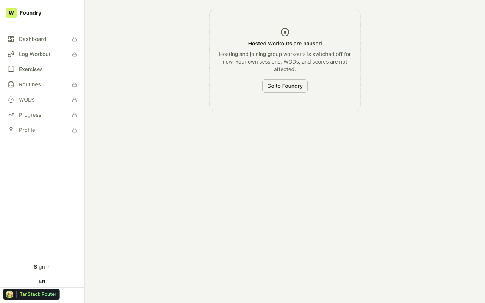
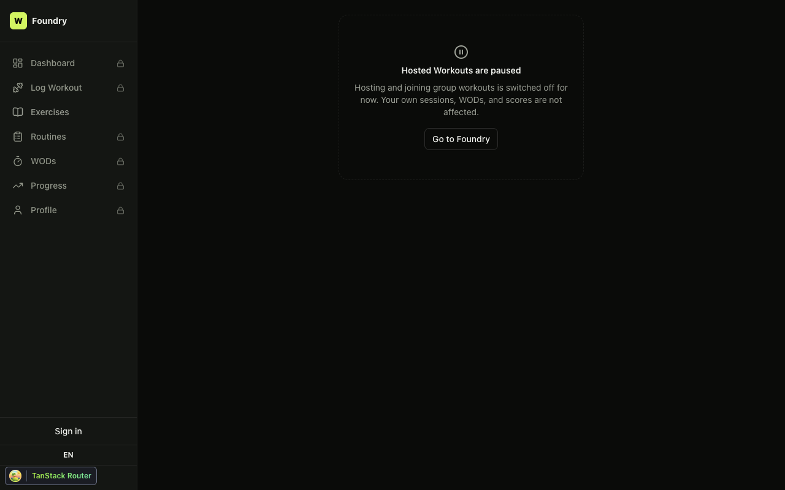
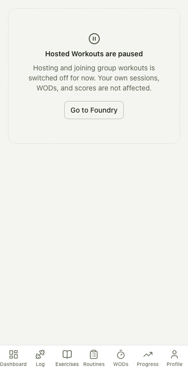
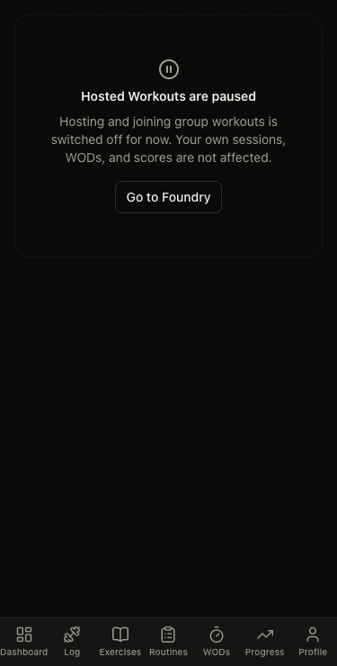
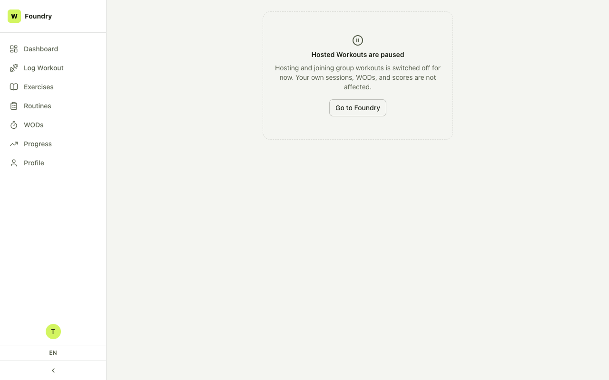
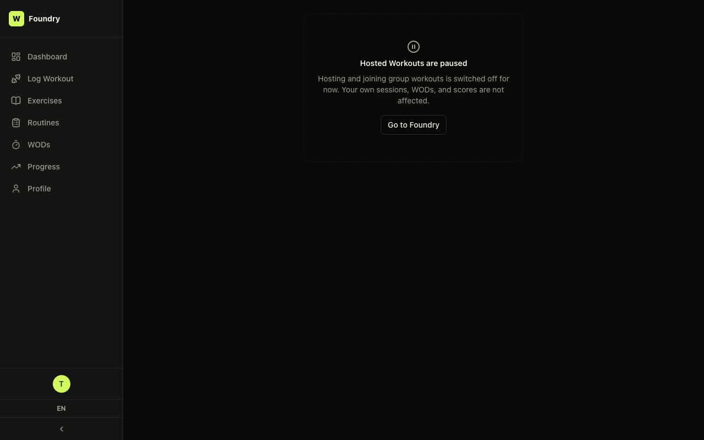
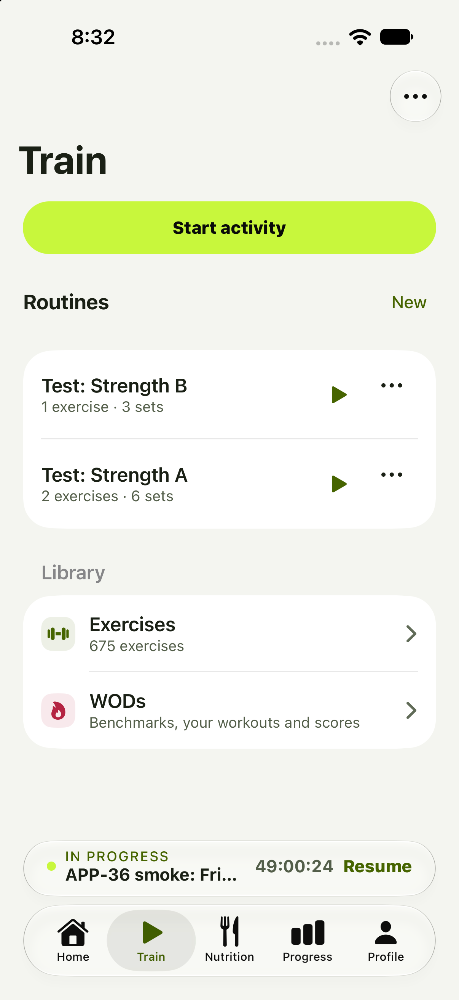
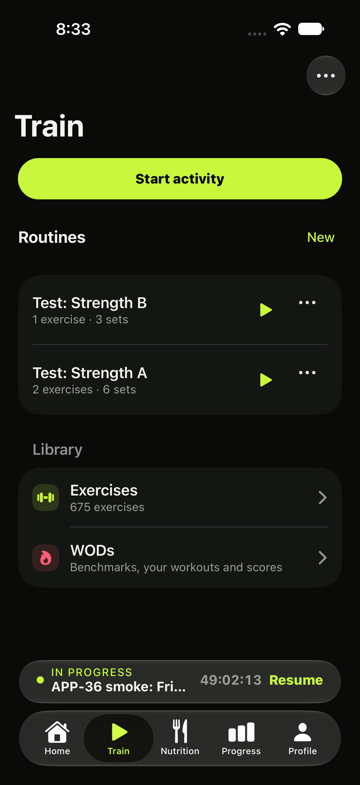
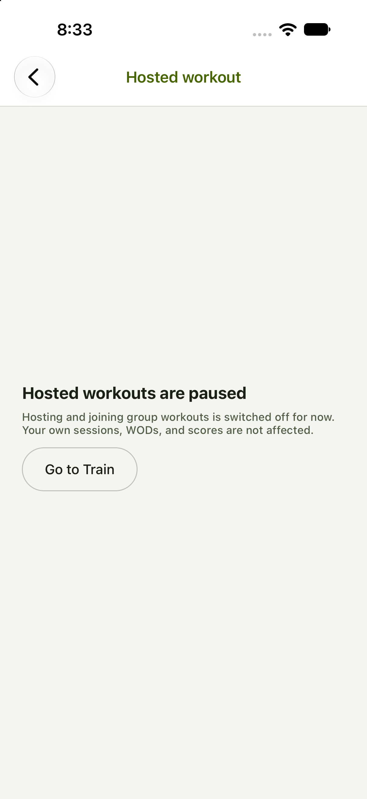
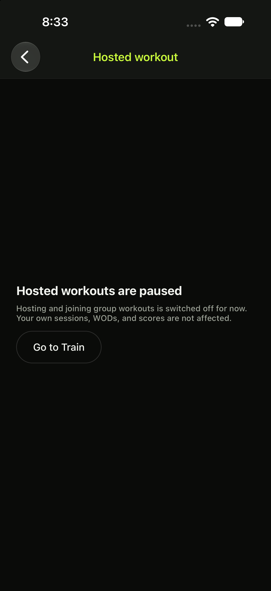

# Hosted Workouts parked — APP-437

Cited by [ADR 0018](../../adr/0018-park-hosted-workouts.md). Built on main at
`f21ddaf3` with the APP-437 changes uncommitted on
`feat/app-437-park-hosted-workouts`; `HOSTED_WORKOUTS_ENABLED` is `false`.

Environment: Vite dev, the shared **dev** Convex deployment, the Clerk
**development** instance, English. Nothing was written to any deployment.

## Web screenshots

Desktop is 1280 px wide, small screen 375 px; light and dark come from
`prefers-color-scheme`. The TanStack devtools badge is hidden in the 375 px
shots so it does not cover the tab bar.

| State | Light | Dark |
| --- | --- | --- |
| `/join/<token>`, signed out, desktop |  |  |
| `/join/<token>`, signed out, 375 px (tab bar without Host) |  |  |
| `/hosted-workouts`, signed in, desktop (nav without Host Workout) |  |  |

The four hosted routes and `/join/$token` share one component, so
`/hosted-workouts/new`, `/hosted-workouts/$id`, and `/hosted-workouts/edit/$id`
look the same; `HostedWorkoutsPaused.test.tsx` checks that each route renders it.

## iOS screenshots

Development dev client on an iOS 27 simulator (iPhone 18 Pro), Metro serving the
shared dev deployment (`run-mobile.mjs` backend check passed), signed in with
the dev test account. The join screen was opened with
`foundry-dev://join/aB3dEfGh5jKmNpQr7t` through `+native-intent.tsx`.

| State | Light | Dark |
| --- | --- | --- |
| Train without the Hosted workouts row |  |  |
| Join link lands on the paused screen |  |  |

Android was not checked.

## Signed-out shell

Before this change every `_app` page crashed for signed-out visitors ("Something
went wrong / Sign in again to continue", seen on production `/exercises` too):
`AppShell` and `ActiveSessionBar` subscribed to `workoutSessions.getActive`,
which requires a user. Both now use `useActiveSession`, which skips the query
until Convex is authenticated. The signed-out `/join` shots above depend on it.
